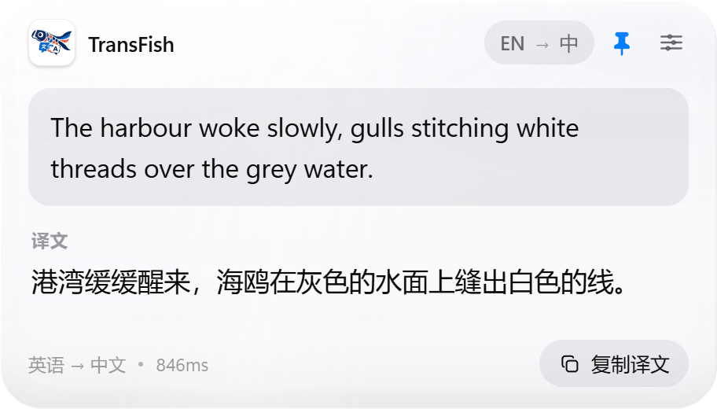

# TransFish

快捷键呼出的即时翻译小窗。按下 `Alt+T`（默认），输入或粘贴一段文字，自动识别语种并翻译；`Esc` 收起，像一张随手拿起的纸条。



> 详细的产品取舍与交互设计见 [docs/DESIGN.md](docs/DESIGN.md)。

## 功能

- **全局快捷键呼出**：默认 `Alt+T`，被占用时自动降级为 `Ctrl+Alt+T` / `Alt+Shift+T` / `Ctrl+Shift+T`，也可在设置里录制任意组合；
- **自动检测语种**：不传源语言，由火山引擎机器翻译自动判断；智能模式下中文译为英文，其余语言译为中文（日文、韩文等），必要时根据检测结果自动纠偏；
- **剪贴板预填**：呼出时若剪贴板有变化，自动填入输入框；只填入不发送，按 `Enter` 才翻译（可关闭）；
- **可拖动、可置顶**：按住顶部握把或标题区拖动窗口，位置自动记忆；标题栏图钉一键切换置顶；
- **托盘常驻**：左键呼出/收起，右键菜单可打开设置、切换置顶、回到顶部居中、切换开机启动、退出；
- **无边框纸片窗**：透明、不占任务栏，首次出现在鼠标所在显示器上方居中，之后记住上次位置，高度随内容自适应。

## 快速开始

### 使用安装包

1. 运行 `TransFish_0.1.1_x64-setup.exe`，按提示安装（当前用户，无需管理员）；
2. 启动后窗口会打开设置页，填入[火山引擎](https://console.volcengine.com/)「访问控制 → 密钥管理」里的 **AccessKey ID** 与 **Secret Access Key**；
3. 点「测试连接」确认通过，保存；
4. 随时按 `Alt+T`（或设置里显示的快捷键）呼出。

密钥只保存在本机 `%APPDATA%\com.transfish.app\settings.json`，不会上传到除火山引擎翻译接口以外的地方。

### 从源码开发

要求：

- Windows 10/11，已安装 [WebView2 运行时](https://developer.microsoft.com/microsoft-edge/webview2/)（Win11 自带）；
- Node.js 20+（开发使用 24）；
- Rust stable + MSVC 工具链（rustup：`stable-x86_64-pc-windows-msvc`），以及 Visual Studio Build Tools 的「使用 C++ 的桌面开发」；
- 火山引擎机器翻译的 AK/SK。

```bash
npm install
npm run app:dev      # 启动 Vite + Tauri 开发窗口
```

首次启动没有密钥时会自动打开设置页。也可以只调前端：

```bash
npm run dev          # http://127.0.0.1:1420，?demo=result / long / error / idle / notice / settings 查看各状态
```

### 构建安装包

```bash
npm run app:build    # 产物在 src-tauri/target/release/bundle/nsis/
```

## 快捷键

| 按键 | 行为 |
| --- | --- |
| `Alt+T`（可改） | 呼出 / 收起 |
| `Enter` | 翻译；译文已是最新时再按一次复制 |
| `Shift+Enter` | 换行 |
| `Ctrl+Enter` | 翻译 |
| `Esc` | 设置页返回；翻译页收起窗口 |
| `Ctrl+,` | 打开 / 关闭设置 |
| 拖动标题栏 | 移动窗口，位置自动保存；托盘「回到顶部居中」可复位 |

## 项目结构

```
src/                     React 前端
  App.tsx                会话状态、翻译序列、全局快捷键、窗口高度
  components/            Translator / Settings / Icons
  lib/                   Tauri 命令封装、语言名称与格式化
  styles.css             纸片与朱砂印视觉
src-tauri/
  src/volc.rs            火山引擎 V4 签名、翻译、语种检测、错误归一化
  src/settings.rs        设置读写与校验、开机启动
  src/window.rs          呼出定位、拖动位置记忆、全局快捷键
  src/tray.rs            托盘与菜单
  src/lib.rs             命令（含置顶切换）、生命周期、失焦策略、单实例
  tauri.conf.json        窗口、CSP、打包配置
docs/DESIGN.md           设计说明
assets/icon.png          图标源文件（scripts/make_icon.py 生成）
```

## 配置说明

| 设置 | 默认 | 说明 |
| --- | --- | --- |
| 目标语言 | 自动 | 自动：中文→英文，其余→中文；也可固定为英/中/日/韩/法/德/西/俄 |
| 呼出快捷键 | `Alt+T` | 点击输入框后按下组合键录制，至少一个修饰键 |
| 失焦自动收起 | 开 | 切到其他窗口时隐藏 |
| 用剪贴板预填 | 开 | 剪贴板相对上次呼出有变化时填入输入框（不自动发送） |
| 粘贴后立刻翻译 | 开 | 在输入框粘贴文本时立即翻译 |
| 窗口置顶 | 开 | 标题栏图钉或托盘菜单切换，立即生效并持久化 |
| 开机自动启动 | 关 | 登录后以 `--hidden` 启动，只驻留托盘 |

设置保存在 `%APPDATA%\com.transfish.app\settings.json`。

## 开发命令

```bash
npm run dev          # 仅 Vite
npm run build        # TypeScript 检查 + 前端构建
npm run app:dev      # Tauri 开发
npm run app:build    # 打包 NSIS 安装包
npm run check:secrets # 扫描仓库里的密钥痕迹（提交前建议跑一次）
cargo test           # src-tauri 下的 Rust 单元测试
```

## 密钥与版本库

AccessKey 只写入 `%APPDATA%\com.transfish.app\settings.json`，该文件位于仓库之外，且
`.gitignore` 与 `scripts/check_secrets.py` 会拦截 `settings*.json`、`AccessKey*.txt`
以及疑似 AK/SK 的内容。不要把真实密钥、包含密钥的截图或配置复制进仓库。

## 已知限制

- 仅面向 Windows；macOS / Linux 未验证；
- 单次翻译上限 5000 字符；
- 密钥以明文 JSON 保存在用户配置目录；
- 尚未接入自动更新与代码签名；
- 韩语、长文本与安装包的干净环境回归仍待完成（见设计文档验收清单）。

## 许可

私有项目，暂未开源授权。
